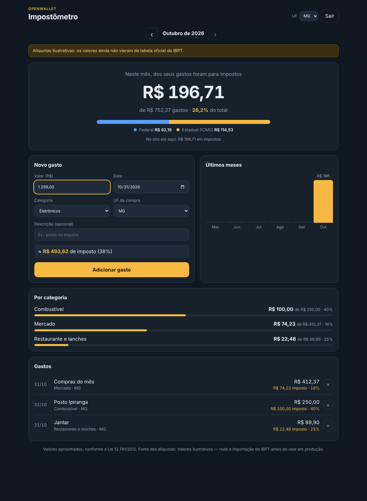

# OpenWallet — Impostômetro

Mostra, para cada gasto, quanto do valor pago foi imposto: federal, estadual (ICMS, conforme a UF) e municipal (ISS).
Os percentuais seguem a lógica da tabela IBPT usada nas notas fiscais (Lei 12.741/2012).



> ⚠️ A tabela que vem no repositório é **ilustrativa**. Antes de produção, importe as tabelas oficiais (veja [Alíquotas](#alíquotas-ibpt)).

## Estrutura

```
packages/tax   cálculo puro (roda no servidor e no navegador) + tabela de alíquotas
apps/api       API REST — Fastify, PostgreSQL, Redis
apps/web       tela do impostômetro — React + Vite
scripts/       importador das tabelas IBPT
```

## Rodando

**Com Docker (tudo junto, 2 réplicas da API):**

```bash
JWT_SECRET=$(openssl rand -hex 32) docker compose up --build
# http://localhost:8080
```

**Desenvolvimento:**

```bash
npm install
cp apps/api/.env.example apps/api/.env   # ajuste DATABASE_URL / REDIS_URL
npm run build -w @openwallet/tax
npm run dev:api    # http://localhost:3000
npm run dev:web    # http://localhost:5173 (encaminha /api para a API)
```

**Testes** (precisam de Postgres em `localhost:5433` e Redis em `localhost:6380`, ou defina `TEST_DATABASE_URL` / `TEST_REDIS_URL`):

```bash
npm test
```

## Como o imposto é calculado

O imposto brasileiro é "por dentro": ele já está contido no preço. Então:

```
imposto = valor pago × (federal% + estadual%[UF] + municipal%) / 100
```

- Tudo em **centavos inteiros**. Cada parcela é arredondada e o total é a soma delas, então os números sempre batem.
- Cada gasto guarda uma **foto** do imposto e da versão da tabela usada (`rates_version`). Se a tabela mudar depois, o histórico não muda.
- A UF vem do perfil, mas pode ser trocada em cada gasto (compra feita em viagem).

## Alíquotas (IBPT)

1. Baixe as tabelas por UF no portal [De Olho no Imposto](https://deolhonoimposto.ibpt.org.br) (arquivos `TabelaIBPTaxSP26.2.A.csv` etc.) e coloque numa pasta, ex. `ibpt-raw/`.
2. Revise o mapeamento categoria → códigos NCM/LC 116 em `packages/tax/data/categories.json`.
3. Rode:

```bash
npm run import:ibpt -- ibpt-raw/
```

O script tira a média das alíquotas dos códigos de cada categoria, por estado, e grava `packages/tax/data/rates.json`.
A tabela do IBPT costuma ser atualizada a cada seis meses: repita o processo e faça o deploy.

## API

| Método | Rota | O que faz |
|---|---|---|
| POST | `/v1/auth/register` · `/login` · `/refresh` · `/logout` | Conta e sessão (access token de 15 min + refresh token rotativo) |
| GET/PATCH | `/v1/me` | Perfil (UF) |
| POST | `/v1/expenses` | Cria gasto já com imposto calculado. Aceita `Idempotency-Key` |
| GET | `/v1/expenses?limit&cursor&from&to&category` | Lista paginada por cursor |
| GET/PATCH/DELETE | `/v1/expenses/:id` | Detalhe, edição (recalcula imposto), exclusão |
| GET | `/v1/impostometro/summary?month=AAAA-MM` | Total do mês, por esfera e por categoria, e acumulado do ano |
| GET | `/v1/impostometro/history?months=12` | Imposto mês a mês |
| GET | `/v1/tax/rates` · `/categories` · `/estimate` | Tabela (com ETag), categorias e simulação |
| GET | `/health/live` · `/health/ready` | Liveness e readiness |

## Decisões para escalar e ficar estável

**API sem estado.** Nada fica na memória do processo: dá para rodar N réplicas atrás de um balanceador (o compose já sobe 2).

**Banco**
- `expenses` é **particionada por hash do usuário** (16 partições). Toda consulta filtra por `user_id`, então cada uma toca uma só partição, e os índices continuam pequenos com milhões de linhas.
- Índice `(user_id, spent_on DESC, id DESC)` atende a lista e o resumo.
- **Paginação por cursor** (keyset), não `OFFSET`: a página 1000 custa o mesmo que a primeira.
- `statement_timeout` e `idle_in_transaction_session_timeout` impedem que uma consulta travada segure conexões.
- Migrações com **advisory lock**: várias réplicas podem subir juntas sem conflito.
- Restrições no próprio banco (valor > 0, imposto = soma das parcelas, imposto ≤ valor).

**Redis (opcional e tolerante a falha)**
- Cache do resumo e do histórico, invalidado por versão a cada gravação do usuário.
- Rate limit compartilhado entre réplicas (300 req/min por usuário; 10/min nas rotas de login).
- Se o Redis cair, a API continua respondendo sem cache (testado), e o readiness mostra `degraded` sem tirar a réplica do ar.

**Robustez**
- `Idempotency-Key` no POST: reenvio por rede ruim ou clique duplo não duplica gasto (testado com requisições simultâneas).
- Refresh token **rotativo** com detecção de reuso: se um token antigo for usado de novo, todas as sessões do usuário caem.
- Senhas com scrypt; login com tempo constante mesmo para e-mail inexistente.
- Desligamento gracioso (SIGTERM): o readiness passa a falhar, as requisições em andamento terminam e só então banco e Redis fecham. Deploys sem 502.
- Validação de toda entrada com zod; limite de 16 KB por requisição; `x-request-id` em todos os logs e respostas.
- Logs estruturados em JSON, com o token removido.

**Cliente**
- A prévia do imposto no formulário é calculada no aparelho, com o mesmo pacote do servidor: resposta instantânea e zero carga extra.
- A tabela de alíquotas é servida com ETag e cache de 1 h.

**Números de referência** (1 instância, 1 vCPU, usuário com 20 mil gastos, 50 conexões simultâneas):

| Rota | Req/s | Latência p50 / p99 |
|---|---|---|
| `GET /impostometro/summary` (com cache) | ~5.100 | 7 ms / 38 ms |
| `GET /expenses?limit=30` | ~1.900 | 23 ms / 56 ms |
| `GET /tax/estimate` | ~11.500 | 3 ms / 12 ms |

### Próximos passos quando o volume crescer
- **PgBouncer** (modo transaction) na frente do Postgres quando o número de réplicas × `DB_POOL_MAX` passar de ~200 conexões.
- **Réplica de leitura** para resumo e histórico (aceitando alguns segundos de atraso).
- **Tabela de resumo mensal** (`user_id, month, category`) atualizada a cada gravação, se o resumo passar a pesar.
- **Métricas** (Prometheus/OpenTelemetry) e alertas de p99 e taxa de erro.
- Autoscaling horizontal da API pela CPU; a API já está pronta para isso.
